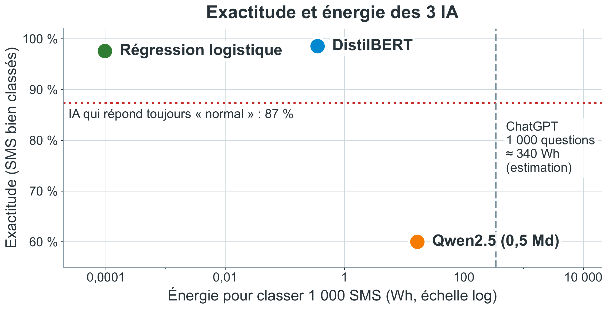

# Une question à ChatGPT, ça consomme combien ?

**Comparateur de modèles d'IA frugale.** Projet du cours « Développement soutenable », Master 1 Informatique, Université d'Évry Paris-Saclay (novembre 2026).
Équipe : Celina, Zina et Anis.

## La question

Pour une tâche simple, a-t-on besoin d'une grosse IA ? On compare trois IA de tailles très différentes sur la même tâche, **repérer des SMS arnaques**, et on mesure leurs performances, leur temps de calcul et leur consommation d'énergie.

## En bref

- La **régression logistique**, la plus petite IA, classe correctement 97,6 % des SMS pour 0,000096 Wh les 1 000 SMS.
- **DistilBERT** fait un peu mieux (98,6 %, F1 de 0,945 contre 0,906), mais consomme environ **3 700 fois plus**.
- Le **mini-chatbot Qwen2.5** fait le moins bien (60 %, moins qu'une IA qui répondrait toujours « normal », qui aurait 87 %) et consomme environ **172 000 fois plus**.

Pour une tâche simple, la plus grosse IA n'est pas la meilleure.

## Les trois IA comparées

| | Modèle | Taille | Utilisation |
|---|---|---|---|
| 1 | Régression logistique (TF-IDF) | environ 7 700 poids | entraînée sur nos SMS |
| 2 | DistilBERT (`distilbert-base-uncased`) | 66 millions de paramètres | pré-entraîné, puis adapté à nos SMS (2 epochs) |
| 3 | Mini-chatbot Qwen2.5 Instruct (`qwen2.5:0.5b` avec [Ollama](https://ollama.com)) | 0,5 milliard de paramètres, version compressée Q4_K_M (environ 400 Mo) | utilisé tel quel : pour chaque SMS, on lui demande « spam ou ham ? » |

## Les données

*SMS Spam Collection* (Almeida, Gómez Hidalgo et Yamakami, 2011), UCI Machine Learning Repository, licence CC BY 4.0 : 5 574 SMS en anglais, étiquetés normal (`ham`) ou arnaque (`spam`). Le notebook télécharge une copie du fichier officiel.

- Après suppression des doublons : 5 171 SMS, dont 653 spams.
- 80 % pour l'entraînement (4 136 SMS), 20 % pour le test (1 035 SMS), séparation stratifiée avec `random_state=42`.
- Les trois IA sont testées sur les mêmes SMS. Le chatbot, plus lent, n'est testé que sur les 200 premiers : les trois IA sont alors aussi comparées sur ces 200 SMS.

## Ce qu'on mesure

- **Performances** : exactitude (accuracy), précision, rappel et F1 sur la classe spam.
- **Temps** de prédiction par SMS.
- **Énergie et CO₂** avec [CodeCarbon](https://github.com/mlco2/codecarbon), avec l'électricité française, ramenés à 1 000 SMS. Le coût de l'entraînement est mesuré à part.

Sous Windows 11, CodeCarbon mesure réellement l'énergie du processeur (Windows Energy Meter Interface). La mémoire, elle, est estimée.

## Résultats

Mesure officielle du 16 novembre 2026, en une seule exécution du notebook, sur un portable Dell (Intel Core i5-8365U, 8 Go de RAM, Windows 11, sans carte graphique), branché sur secteur.

| IA | Exactitude | Précision | Rappel | F1 | Temps par SMS | Énergie / 1 000 SMS | CO₂ / 1 000 SMS |
|---|---|---|---|---|---|---|---|
| Régression logistique | 97,6 % | 0,896 | 0,916 | 0,906 | 0,014 ms | 0,000096 Wh | 0,000005 g |
| DistilBERT | 98,6 % | 0,914 | 0,977 | 0,945 | 51 ms | 0,35 Wh | 0,020 g |
| Qwen2.5 (200 SMS) | 60,0 % | 0,078 | 0,400 | 0,130 | 2,4 s | 17 Wh | 0,93 g |

- Sur les 200 SMS testés par le chatbot, la régression logistique a 98,5 % d'exactitude et DistilBERT 99,5 %.
- Énergie par rapport à la régression logistique : × 3 664 pour DistilBERT, × 172 352 pour Qwen2.5.
- Entraînement : 0,14 s (0,001 Wh) pour la régression logistique, 24 min (10 Wh) pour DistilBERT.



Ce qu'on retient :

- La puissance du PC reste presque la même pour les trois IA, environ 25 W (15 W de processeur mesurés et 10 W de mémoire estimés) : l'écart d'énergie vient surtout du temps de calcul.
- DistilBERT rate moins d'arnaques que la régression logistique (3 au lieu de 11) et donne un peu moins de fausses alertes (12 au lieu de 14).
- Le chatbot a répondu « spam » pour 77 SMS sur 200, dont seulement 6 vraies arnaques, et il a raté 9 arnaques sur 15.
- Une recharge de smartphone (environ 22 Wh, Luccioni et al., 2024) suffit pour classer environ 230 millions de SMS avec la régression logistique, ou pour poser environ 65 questions à ChatGPT (0,34 Wh par question selon S. Altman).

Autres graphes : [énergie des 3 IA en barres](figures/energie_barres.png) et [matrices de confusion](figures/matrices_confusion.png).
Chiffres complets : [resultats/comparison.csv](resultats/comparison.csv) et [resultats/entrainement.csv](resultats/entrainement.csv).

## Refaire l'expérience

**Prérequis** : Python 3.11 ou plus récent (testé avec Python 3.14.2 sous Windows 11), [Ollama](https://ollama.com/download), quelques Go d'espace libre et une connexion Internet pour télécharger les données et les modèles (environ 700 Mo).

1. Récupérer le projet : bouton **Code → Download ZIP** puis décompresser, ou `git clone` de ce dépôt .
2. Dans l'Invite de commandes Windows, depuis le dossier du projet :
   ```
   py -m venv .venv
   .venv\Scripts\activate
   pip install -r requirements.txt
   ```
   Sous macOS ou Linux : `python3 -m venv .venv` puis `source .venv/bin/activate`.
3. Installer Ollama, puis télécharger le chatbot (environ 400 Mo) et laisser Ollama ouvert pendant toute la mesure :
   ```
   ollama pull qwen2.5:0.5b
   ```
4. Lancer `jupyter notebook`, ouvrir `experience_ia_frugale_finale.ipynb` et lancer toutes les cases dans l'ordre (menu **Run → Run All Cells**). Sur notre PC, cela prend moins d'une heure.

**Conditions de mesure** : les trois IA sur le même PC, branché sur secteur, avec les autres applications fermées et la mise en veille désactivée. Pour tester le chatbot sur les 1 035 SMS, mettre `NB_TEST_LLM = None` dans les paramètres (environ 35 minutes de plus sur notre PC).

**Fichiers produits par le notebook** :
- `comparison.csv` : résultats d'inférence des trois IA ;
- `entrainement.csv` : coût de l'entraînement ;
- `exactitude_vs_energie.png` : le graphe de la partie 9 ;
- `exactitude_vs_energie.pdf`, `energie_barres.pdf`, `matrices_confusion.pdf` (et leurs `.png`) : les graphes du poster (partie 12).

Les résultats de la mesure officielle sont rangés dans les dossiers `resultats/` et `figures/`.

## Limites

- Un seul PC et une seule tâche.
- CodeCarbon mesure le processeur, mais estime la mémoire (10 W fixes, environ 40 % de l'énergie totale).
- Le chatbot n'est testé que sur 200 SMS, et son score dépend beaucoup de la question qu'on lui pose.
- Un seul entraînement de DistilBERT est mesuré. Sur deux essais, son exactitude variait entre 98,6 et 99,1 %.
- Ne sont pas comptés : le pré-entraînement de DistilBERT et l'entraînement de Qwen, faits par leurs créateurs.
- Les SMS datent de 2011 : les arnaques d'aujourd'hui sont différentes.
- Le chiffre de ChatGPT (0,34 Wh par question) est une déclaration de Sam Altman (juin 2025), pas une mesure. Une question à ChatGPT n'est pas la même tâche que classer un SMS.

## Références

- Henderson, P., Hu, J., Romoff, J. et al. (2020). *Towards the Systematic Reporting of the Energy and Carbon Footprints of Machine Learning.* Journal of Machine Learning Research, 21, 1-43. https://www.jmlr.org/papers/v21/20-312.html
- Luccioni, A. S., Jernite, Y. et Strubell, E. (2024). *Power Hungry Processing: Watts Driving the Cost of AI Deployment?* ACM FAccT '24. https://doi.org/10.1145/3630106.3658542
- Almeida, T. A., Gómez Hidalgo, J. M. et Yamakami, A. (2011). *Contributions to the Study of SMS Spam Filtering: New Collection and Results.* ACM DocEng '11. Données : https://doi.org/10.24432/C5CC84
- CodeCarbon : https://github.com/mlco2/codecarbon
- Ollama : https://ollama.com
- Altman, S. (2025). *The Gentle Singularity*, billet de blog, 10 juin 2025.
